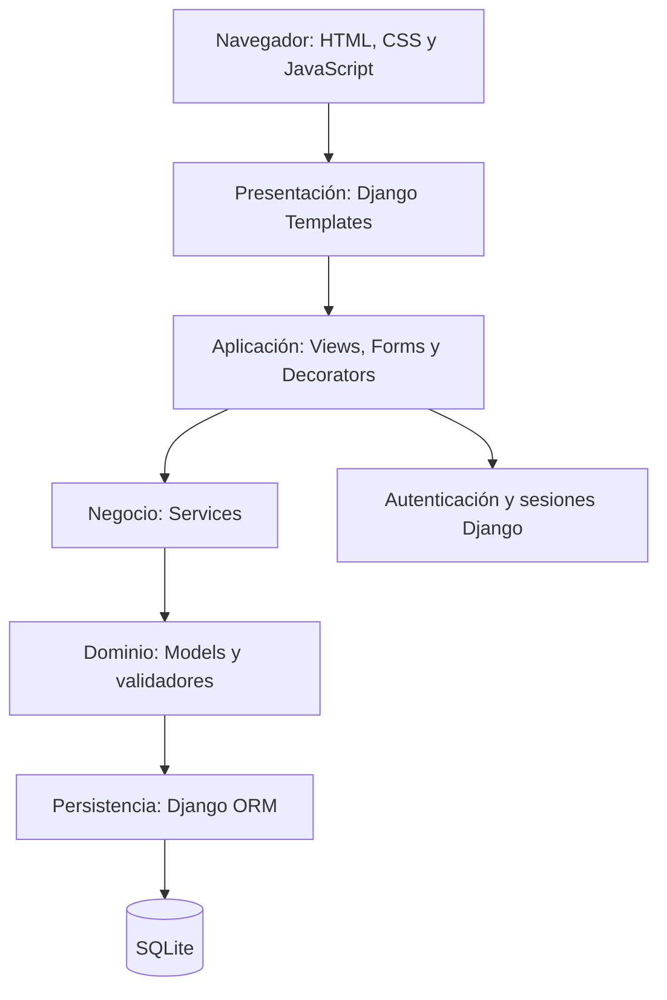
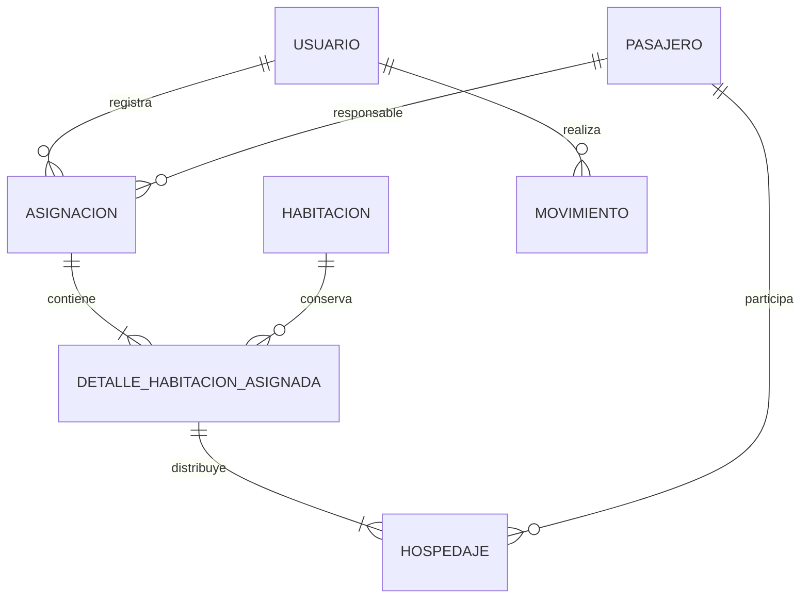
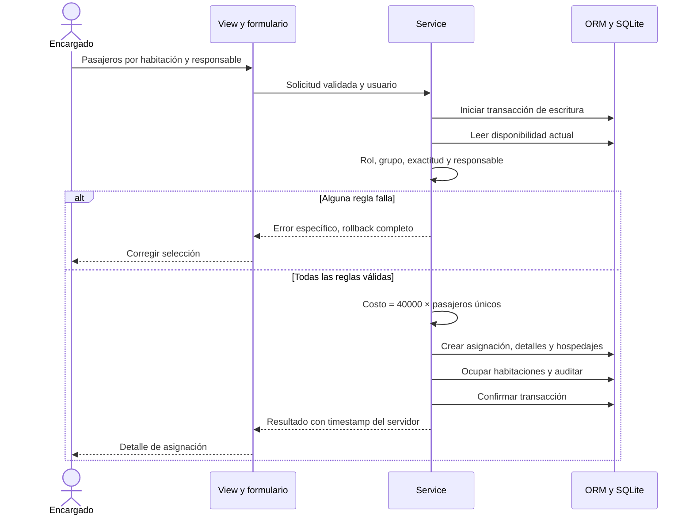

# Arquitectura y modelo del prototipo

El sistema usa una arquitectura cliente-servidor organizada por capas. Un navegador muestra plantillas Django; el servidor autentica al usuario, verifica el rol y ejecuta servicios de negocio sobre una base SQLite. Esta separación conserva las reglas del hotel aunque cambie el diseño de una pantalla.

| Capa | Archivos | Responsabilidad |
|---|---|---|
| Presentación | `hotel/templates/hotel/`, `hotel/static/hotel/` | Mostrar datos, navegación y ayuda para distribuir pasajeros. |
| Aplicación | `hotel/views.py`, `forms.py`, `decorators.py`, `urls.py` | Validar solicitudes, proteger rutas, seleccionar pantallas y mensajes. |
| Negocio | `hotel/services.py` | Asignación exacta, responsable, costo, cierre, baja controlada y ocupación. |
| Dominio | `hotel/models.py` | Entidades, relaciones, unicidad, estados e integridad histórica. |
| Persistencia | ORM, `hotel/migrations/` y SQLite | Consultas parametrizadas, esquema y transacciones. |
| Configuración | `config/settings.py`, `.env` | Entorno, secretos, sesiones, hosts y transporte. |

## Modelo y adaptación del UML

`Usuario` es un usuario personalizado de Django definido desde la migración inicial. `ADMINISTRADOR` y `ENCARGADO` son valores de un rol del usuario, sin duplicar identidad, contraseña o sesión en tablas distintas. Esta adaptación conserva la separación de responsabilidades del UML E2.

`Hospedaje` concreta la relación entre un detalle de habitación y cada pasajero. Permite reconstruir quién durmió en cada habitación y restringir la doble ocupación de una persona. La asignación contiene exactamente un responsable perteneciente a los huéspedes del grupo. Las relaciones históricas se protegen contra borrado; una habitación dada de baja conserva su identidad y relaciones.

Los nombres, RUT, número y capacidad se copian como valores históricos al confirmar una estadía. Así, corregir después el nombre de una persona o los datos de una habitación no reescribe lo registrado en una contratación anterior. `Movimiento` almacena eventos de actividad; `LoginIntento` permite registrar fallos y un bloqueo temporal de autenticación.

La habitación tiene un estado operativo Vacante/Ocupada y un indicador activo/inactivo. El primero describe ocupación; el segundo determina si puede utilizarse en contrataciones nuevas. Su número sigue reservado después de la baja para impedir que otro registro suplante la identidad de su historial.

## Flujo transaccional de asignación

El navegador puede ayudar a mostrar el conteo y resumen, pero no determina el costo persistido ni la disponibilidad definitiva. El servicio vuelve a leer el estado al confirmar. Una habitación con tres plazas requiere exactamente tres pasajeros; dos o cuatro producen un rechazo y ningún cambio parcial.

## Concurrencia

SQLite se configura para iniciar las transacciones de escritura como `IMMEDIATE`, serializando cambios breves. Las restricciones de unicidad para habitación activa y pasajero alojado refuerzan la validación de los servicios. Ante competencia o bloqueo, el sistema debe rechazar la operación de manera controlada y conservar la transacción completa.

SQLite admite un escritor a la vez. El prototipo es adecuado para la demostración académica en una instancia; la suite funcional no acredita capacidad para múltiples recepciones bajo alta carga. Antes de escalar a varias instancias, medir contención, revisar tiempos de espera y migrar a una base cliente-servidor, manteniendo las mismas reglas.

## Liberación e historial

El servicio de salida opera sobre la asignación completa: registra fecha y usuario de salida, finaliza los hospedajes, libera todas sus habitaciones y conserva el costo, responsable y registro de entrada. La baja lógica solo se admite cuando no existe ocupación ni asignación activa. No existe una operación de interfaz para borrar o reescribir estadías anteriores.

La protección se aplica en la aplicación y el esquema; una persona con acceso directo al archivo de base de datos o al código puede alterar el sistema. La evidencia histórica no equivale a almacenamiento forense inviolable. En producción, restringir acceso al disco y respaldos, controlar privilegios y almacenar eventos externos si se necesita mayor resistencia a manipulación.

## Por qué esta arquitectura

Las funciones pertenecen a un único hotel y comparten transacciones de habitaciones y pasajeros. Un monolito por capas evita coordinación distribuida y permite demostrar atomicidad, autorización y trazabilidad con herramientas disponibles. No se requiere P2P ni microservicios para esta escala. WSGI permite separar la ejecución local del servidor de desarrollo y alojar la aplicación posteriormente en PaaS.
