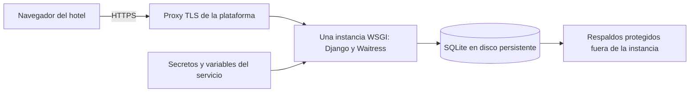

# Preparación para Cloud y PaaS

La aplicación puede ejecutarse como un servicio web WSGI. La configuración por entorno, las dependencias fijadas y los estáticos locales permiten trasladar el mismo código a una plataforma PaaS. Esta entrega se verifica en local; no contiene evidencia de alojamiento público.

## Aplicación a la rúbrica E3

El hotel ofrece su sistema a usuarios internos mediante navegador, siguiendo un modo de consumo de software como servicio. Una PaaS puede aportar ejecución, HTTPS y gestión de procesos; una IaaS dejaría además al equipo la instalación y mantenimiento del sistema operativo y servidor. La solución propone PaaS para reducir trabajo operacional, sin presentar la instancia local como una implementación Cloud ya realizada.

No se agrega una integración externa innecesaria para la demostración. El diseño y los archivos de configuración son evidencia de preparación; una calificación que exija incorporación efectiva de una tendencia Cloud debe incluir el despliegue real, su URL y verificaciones posteriores.

## Topología propuesta



La instancia única es una decisión necesaria mientras se utiliza un archivo SQLite local. No usar almacenamiento efímero: al reconstruir o reiniciar el servicio se podrían perder las estadías. No ejecutar réplicas con copias independientes de la misma base.

## Configuración requerida

| Opción | Requisito |
|---|---|
| `DJANGO_ENV` | `production`. |
| `DEBUG` | `False`. |
| `SECRET_KEY` | Valor aleatorio privado del servicio; sin subirlo al repositorio. |
| `ALLOWED_HOSTS` | Dominio real del servicio; evitar comodines. |
| `CSRF_TRUSTED_ORIGINS` | Origen HTTPS real, si se requiere por proxy/dominio. |
| `DB_PATH` | Ruta absoluta dentro del volumen persistente. |
| HTTPS | Certificado y redirección verificados en navegador. |
| Proxy | Configurar confianza en cabeceras solo si el proxy las limpia y controla. |
| Sesiones | Cookies seguras, HttpOnly y SameSite; tiempo de inactividad definido. |

Los valores de desarrollo no se deben trasladar automáticamente. Las variables demo solo se necesitan para demostraciones académicas; crear credenciales operativas distintas y revisar la gestión inicial de identidades antes de un uso real.

## Secuencia de preparación

En una terminal del servicio con el entorno configurado:

```text
python -m pip install -r requirements.txt
python manage.py migrate
python manage.py collectstatic --noinput
python manage.py check --deploy
python scripts/serve.py
```

El proceso WSGI usa las variables `HOST` y `PORT`. En PaaS, definir `HOST=0.0.0.0` y usar el puerto asignado por la plataforma. `Procfile` declara el proceso web. Para la demostración académica, mantener los valores predeterminados `127.0.0.1:8000`. Mantener DEBUG desactivado y ejecutar la prueba de configuración bajo el mismo entorno de producción que se empleará al servir.

## Validaciones posteriores

1. Verificar que HTTP redirige a HTTPS y que el certificado cubre el dominio.
2. Abrir login, autenticar ambos roles y comprobar sus rechazos por URL directa.
3. Confirmar que CSS, iconos y JavaScript responden con `collectstatic` aplicado.
4. Crear una asignación exacta, probar otra inválida y confirmar ausencia de cambios parciales.
5. Registrar salida y comprobar conservación de historiales.
6. Reiniciar la instancia y comprobar persistencia de datos.
7. Crear un respaldo, restaurarlo en un entorno independiente y validar consultas.
8. Revisar logs, uso de disco, tiempo de respuesta y responsables de incidentes.

Registrar fecha, URL, configuración sin secretos y resultados en una evidencia nueva. No cargar datos reales para la primera verificación.

## Continuidad y escalado

El comando `backup_database` facilita una copia consistente; se debe programar su frecuencia, rotación y almacenamiento protegido. Definir una pérdida de datos tolerable y un tiempo de recuperación aceptable antes de operar. Hacer una copia no acredita recuperación: restaurar y comprobarla periódicamente.

Para crecimiento significativo, medir concurrencia y migrar a una base de datos relacional administrada como PostgreSQL cuando sea necesario. Esta entrega mantiene SQLite; no incluye una migración ni declara disponibilidad de múltiples instancias. Revisar transacciones, bloqueos y pruebas bajo el nuevo motor antes de escalar.
